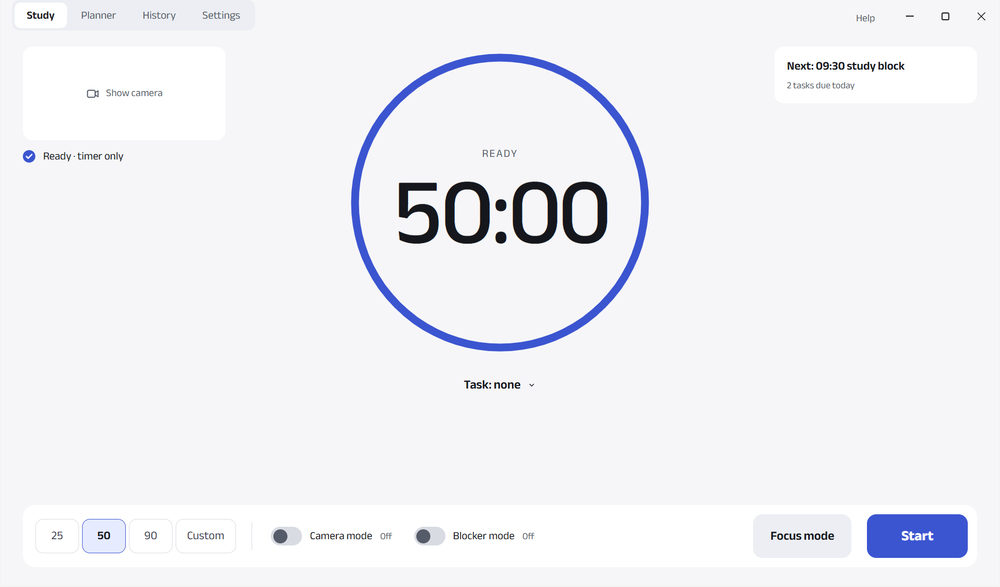
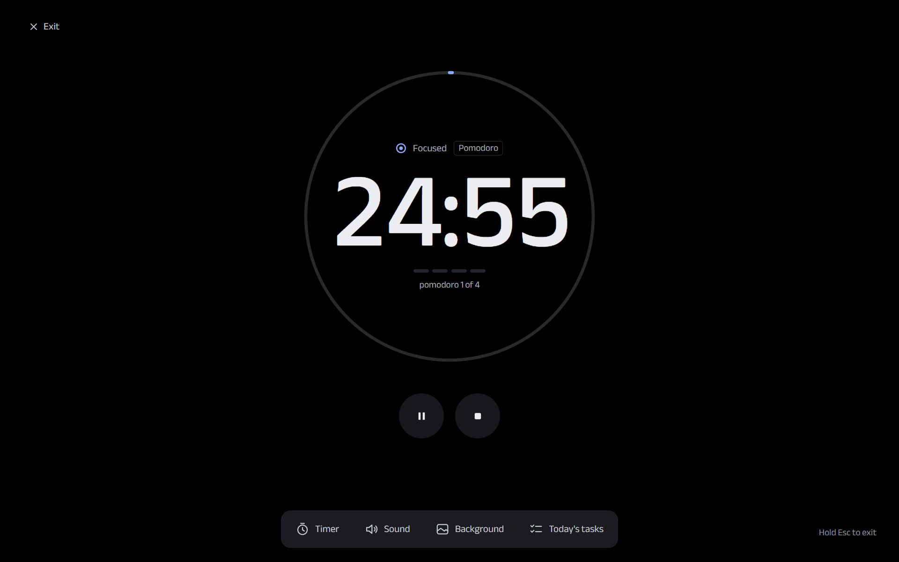

# Desk Watch


> **Beta (0.1.1-beta): still being tested.** Windows 10/11 only. Tried it? [Tell me how it went (3 questions, 1 minute)](https://forms.gle/HahLMNuUL9vcB3sU9) or report problems on the [Issues page](https://github.com/hrishinthecoder/desk-watch/issues).

A study-focus app. It watches your webcam while you study and rings an alarm when you pick up your phone, leave your
desk, look away, or fall asleep. It also times your sessions, plans your tasks, and can block distracting sites and apps.

**Everything stays on your computer.** No account, no cloud, no tracking. Camera images are never saved or sent.

English and বাংলা. Free and open source (MIT).



## Install

1. Download `Desk-Watch-Setup-0.1.1-beta.exe` from [Releases](../../releases).
2. Windows SmartScreen warns you (the installer is not code-signed): click **More info** → **Run anyway**.
3. Follow the short setup: camera, aim check, 30-second calibration.

## Features

- **Alarms:** phone in your hand or at your ear, leaving the desk, looking away, falling asleep.
- **Study sessions** with a clock that only counts real study time, plus breaks and pause.
- **Focus mode:** full screen with Pomodoro, Countdown or Count-up, background noise, and a small always-on-top timer.
- **Planner:** to-do list, Board, weekly routines, day view, reminders.
- **Reports:** one plain sentence per session, History by day, task and subject.
- **Blocker mode** (Chrome and Edge, with the included extension): blocks sites and apps during a session.
- **Quiet sessions:** website notifications in Chrome and Edge are blocked while a session runs, and a reminder opens
  Windows' Do not disturb.
- **Your data:** export, weekly backups, restore, delete everything.



## Known limits

- The phone model was trained on one person, in one room, at night, wearing glasses. It may miss your phone.
- Glasses can hide closed eyes. A phone lying flat on the desk can be counted as sleepy.
- No Firefox support for blocking. Mac and Linux are not supported.

## Feedback

Used Desk Watch for a session? [Answer 3 quick questions](https://forms.gle/HahLMNuUL9vcB3sU9). It takes a minute, needs no account, and tells me what to fix first. Found a bug? Open an [issue](https://github.com/hrishinthecoder/desk-watch/issues).

## Build from source

Needs [Node.js](https://nodejs.org).

```bash
npm install
```

```bash
npm run assets
```

```bash
npm start
```

`npm test` runs the tests; `npm run dist` builds the installer. How to help: [CONTRIBUTING.md](CONTRIBUTING.md).

Everything in detail (all features, privacy, Blocker mode setup, developer notes): [the full guide](docs/README_FULL.md).

## Licence

[MIT](LICENSE), © 2026 Hrishin Debnath. Third-party parts: [THIRD_PARTY_NOTICES.md](THIRD_PARTY_NOTICES.md).
