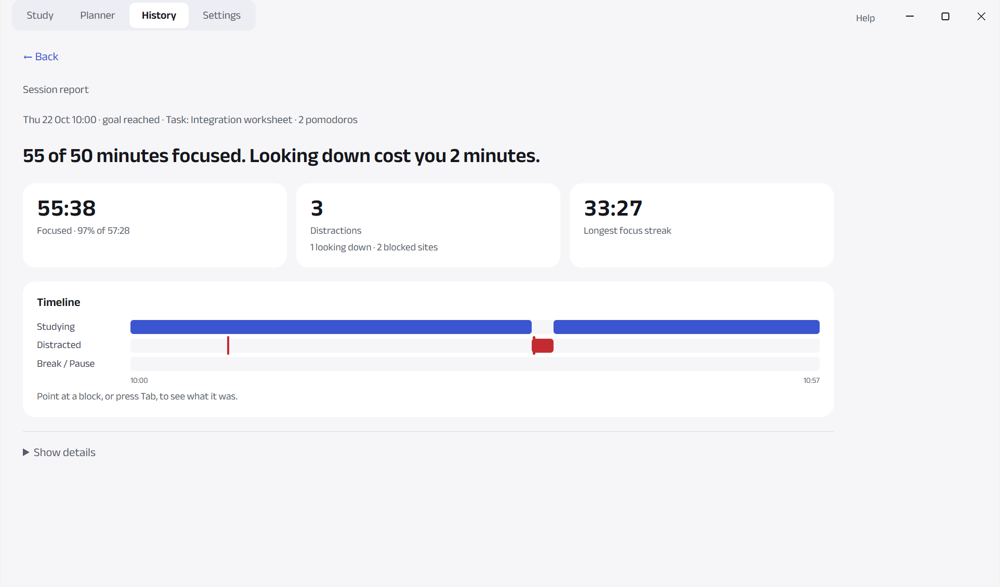
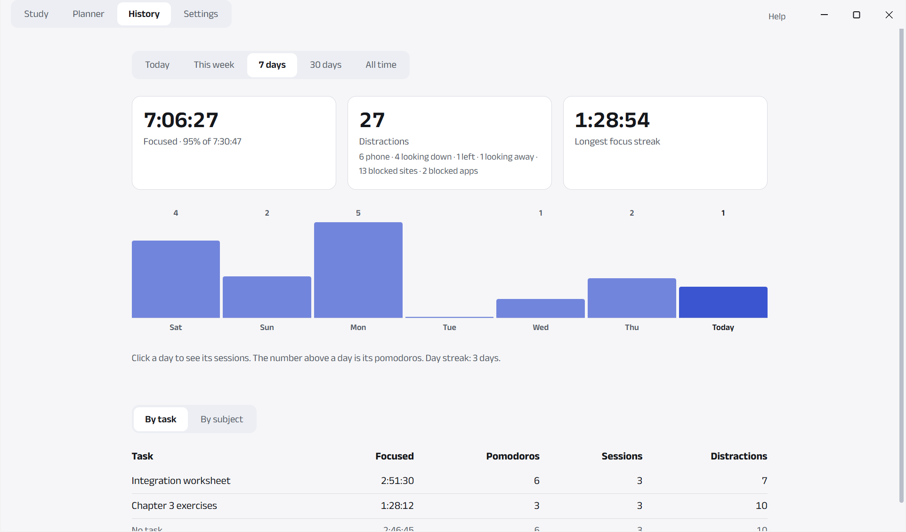
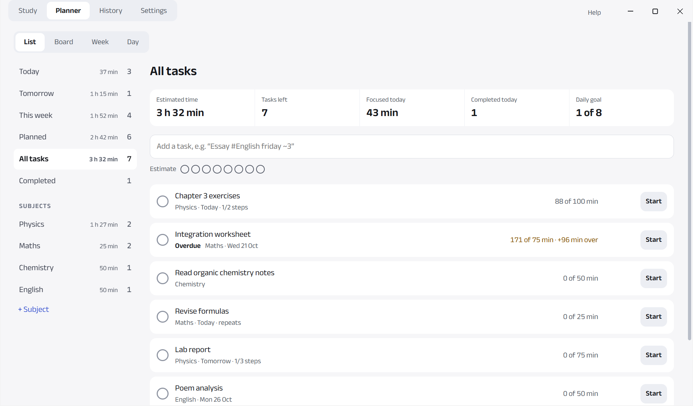
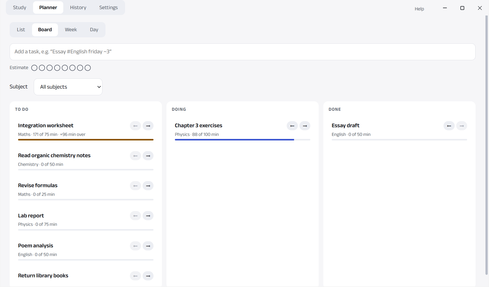
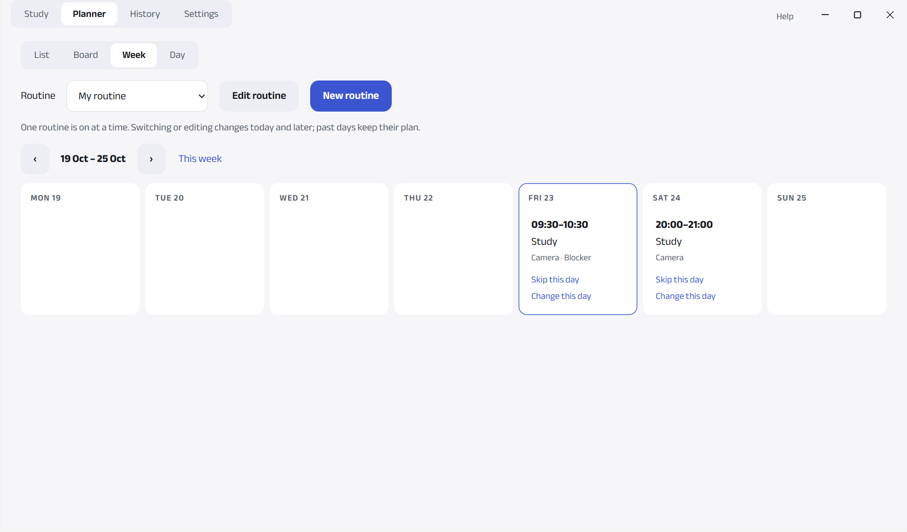

# Desk Watch: the full guide

The short version is the [README](../README.md).

> **Beta: still being tested.** Version 0.1.0-beta. Expect some rough edges; please report problems on the Issues page.

A study-focus app for Windows. It watches your webcam while you study and rings an alarm when you pick up your
phone, leave your desk or look away for too long. It also times your study sessions, plans your tasks and routines,
shows honest reports, and (in Blocker mode) blocks distracting websites and apps.

**Everything stays on your computer.** No account, no cloud, no tracking. Camera images, sound and screen images
are never saved or sent anywhere.

English and বাংলা (Bangla). Free and open source (MIT).


| Session report | History |
|---|---|
|  |  |
| **To-do list** | **Board** |
|  |  |
| **Weekly routine** | **Focus mode (full screen)** |
|  |  |

Dark theme: [Study screen](screenshots/dark-study.png). The screenshots use made-up data.

> Status: beta (0.1.0-beta). Windows only for now.

---

## Download and install

1. Download `Desk-Watch-Setup-0.1.0-beta.exe` from the [Releases](https://github.com/hrishinthecoder/desk-watch/releases) page.
2. Open it. **Windows SmartScreen will warn you** ("Windows protected your PC"), because the installer is not
   code-signed (signing costs money every year, and this is a free project). To continue:
   1. click **More info**;
   2. check that the app is **Desk Watch** (publisher: *Unknown publisher*);
   3. click **Run anyway**.

   Only do this for a file you downloaded from this project's own Releases page. If you prefer not to, you can
   [build it from source](#build-from-source) instead.
3. Choose where to install it (it installs for your Windows user only; no admin rights needed) and click **Install**.
4. Desk Watch opens with a short setup: camera, aim check, calibration, and an optional practice session.

To uninstall: Windows Settings → Apps → Desk Watch → Uninstall. Your data stays in `%APPDATA%\Desk Watch` until you
delete it (or use Settings → Your data → Delete everything first).

## What it does

- **Phone detection.** You get an alarm when a phone is in your hand or at your ear.
  A phone lying flat on the desk does not ring the phone alarm (see Known limits).
- **Presence.** You get an alarm when you leave the desk, or look away for more than 20 seconds (you can change this).
- **Sleepy alarm.** "Wake up" when both eyes stay closed for 6 seconds, or your head rests on the desk for 15 seconds
  (both times can be changed; switch it off in Settings → Sessions). Sleepy time is not study time. Blinks, slow blinks
  and reading with your eyes down do not count. Short eye closures (1.5–6 s) only add up to a quiet hint:
  "You look sleepy. Take a short break?".
- **Activity estimates.** It guesses whether you are writing, reading, speaking or sitting idle.
  These are estimates and can be wrong.
- **Study sessions:**
  - choose how many minutes;
  - Start, Break (with a countdown), Pause and End;
  - the study clock counts only time spent studying.
- **Strict mode.** To end a session early, you must type a long sentence.
- **Camera check before a session.** With Camera mode on, the session starts as soon as the camera sees your face
  (at most 3 seconds). If it can't, choose **Fix it** or **Start anyway** (you count as away until it sees you).
- **Reports:**
  - after each session: one plain sentence ("38 of 50 minutes focused. Your phone cost you 7 minutes."), then three numbers:
    focused time, distractions (with a breakdown such as "4 phone · 2 looking down · 1 left") and longest focus streak;
  - a timeline with three labelled rows (Studying, Distracted, Break / Pause); point at a block to see what it was;
  - details (time per activity, sites and apps) on demand;
  - History: Today, This week, 7 days, 30 days and All time with the same three numbers, a bar per day (with its
    pomodoros), and your day streak; a **By task / By subject** table (focused time, pomodoros, sessions, distractions);
  - This week also says your best day, your top distraction and your phone pickups compared with last week;
  - a session report also says its task and pomodoros.
- **Week starts on** any day (Settings → App), for the Planner's week and History's This week.
- **Low-power mode** (Settings → Advanced → Performance: Auto / Full / Low power). Auto measures your computer's speed
  after start and, only if it is too slow, uses a smaller phone model and then checks 2 times a second instead of 5.
  On the owner's test clips both caught the same phones as the full mode; at 2 checks a second the alarm rang about
  1 second later.
- **Planner:**
  - to-do list: lists for Today, Tomorrow, This week, Planned, All tasks, Completed and your own subjects, each with
    its count and estimated time left; a stats row (estimated time, tasks left, focused today, completed today);
  - quick add with shortcuts: `Essay #English friday !1 ~3` = subject, due date, priority, 3 pomodoros (shown as chips first);
  - a task has notes, steps, a due date and time, repeat (daily, weekdays, weekly), priority and an estimate in pomodoros (at most 12)
    (kept as minutes, so changing the pomodoro length later never changes old estimates);
    "Overdue" is shown as a word; ticking it shows Undo for 5 seconds; a repeating task plans its next copy;
  - drag to reorder (or ↑ ↓); Ctrl+K searches titles, notes and steps; keys N, Enter, Space, Delete;
  - a pomodoro is 25 minutes of camera-checked focused time; a task shows its progress in minutes ("40 of 75 min"),
    and going over its estimate plainly ("+96 min over", in amber);
  - a daily goal in pomodoros ("3 of 8", Settings → Pomodoro); ticking a task with an estimate says
    "Estimated 4 pomodoros, took 6.";
  - a Day view: one day on a time line, what was scheduled (weekly blocks, tasks with a time) next to what was done
    (your real sessions); click a session for its report;
  - a board (To do / Doing / Done) of the same tasks: compact cards (subject, estimate, progress), a subject filter,
    click a card for its details, drag to reorder or to another column, or use the ← → buttons;
  - routines (Planner → Week): named routines such as "HSC weekly", one on at a time; time slots on one or more days
    (start, end, subject or task, Camera/Blocker mode, an optional block set); "Copy this day to…"; changes apply from
    today (past days keep their plan); skip or move one day without changing the routine;
    click a block (or its reminder notification) and the Study tab is filled in; you press Start;
  - link a session to a task: each task shows how long you studied for it, and after the session
    Desk Watch asks "Mark this task as done?";
  - when a block starts, Desk Watch comes to the front, plays a short sound and shows a reminder bar
    (also a Windows notification, if notifications are on); switch reminders off in Settings; none while a session runs.
- **Focus mode:** a full-screen, black view of the normal session (camera alarms, the blocker, History and the task's
  minutes all keep working):
  - opens from a task's Start (which first asks for your timer: focus and break length, number of pomodoros), the Study
    tab's **Focus mode** button, or **Full screen** during a session;
  - timers: Pomodoro (25 / 5 × 4, a 15-minute break after every 4th; all editable; the run ends after its last
    pomodoro), Countdown, Count-up (with a limit); full-screen breaks with "Start next pomodoro" (or start it by itself,
    Settings → Pomodoro);
  - background noise (white, pink, brown; made on your computer, no sound files), and Black / Dark grey / Deep green /
    Deep blue backgrounds;
  - today's tasks slide in from the right: tick one, or switch task (each task keeps its own minutes);
  - hold Esc 2 seconds or click Exit to leave; "Keep going in a small window" shows a small always-on-top timer.
- **Languages:** English and বাংলা (Settings → App → Language, or the first setup step). Bangla mode uses Bangla
  digits, dates and weekday names; the tray menu and notifications follow too. The Debug tab stays in English.
- **Workstations.** Calibrate once per desk or place, and Desk Watch remembers it.
- **Blocker mode** (Windows, with Chrome or Edge):
  - blocks sites on your list during a session; a "Back to work" page appears instead;
  - a blocked app gets a warning first ("Close it, or the alarm rings in 10 s"), then the alarm;
  - a blocked site gets its block page and a warning; going back to it within 2 minutes, or a 3rd blocked visit in a
    session, rings the alarm (no admin rights, no system files changed);
  - logs time per site and app.
- **Your data:**
  - export to CSV or JSON;
  - import from JSON;
  - a backup once a week (the newest 4 are kept), **Back up now**, and **Restore** any of them
    (your current data is backed up first);
  - delete everything, backups included, with one button.

## Privacy promise

- Video is processed live, in memory, on your computer, and then thrown away.
- Nothing is uploaded. The app blocks all internet access for itself, apart from your own computer.
- The detection models are included in the app, so no models are downloaded while it runs.
- Blocker mode reads only the **name** of the program in front (for example "chrome.exe"). It never reads
  window titles, and never takes screenshots or records the screen.
- The browser extension talks only to Desk Watch on your own computer (`127.0.0.1`), never to the internet.
- Your data lives in one file: `%APPDATA%\Desk Watch\deskwatch.db`, plus weekly copies of it in
  `%APPDATA%\Desk Watch\backups\`. Settings has buttons that open both folders.
- The only video ever saved is a **test clip** you record on purpose in the Debug tab (hidden unless you switch it on).
  Clips are never recorded during sessions.

## Requirements

- Windows 10 or 11 (64-bit). Mac and Linux are not supported yet.
- A webcam that sees your face and hands.
- For Blocker mode: Chrome or Edge.

## First use

The first time Desk Watch opens, a short setup guides you (you can skip it, and it continues where you left off
if you close the app):

1. **Welcome** and the privacy promise (and the language: English or বাংলা).
2. **Camera:** turns it on.
3. **Aim check:** live ticks for Face, Hands and Desk, each with a short fix.
4. **Calibration** (30 seconds: writing, reading, sitting still), saved as your first place.
5. **Browser connection** (optional, for Blocker mode).
6. **Practice session** (optional, 2 minutes, never saved): pick up your phone when asked, hear the alarm,
   put it down and watch the clock start again.

Then a short tour shows the Study screen. **Help** (top right) replays the tour of any screen or runs setup again;
running it again never changes your sessions, tasks, block sets or saved places.

## Blocker mode (blocking sites and apps)

1. Install the browser extension once. It isn't in the Chrome or Edge store yet, so:
   1. In Desk Watch, go to **Settings → Blocker mode → Open extension folder**.
   2. In Chrome, open `chrome://extensions` (in Edge, `edge://extensions`).
   3. Switch on **Developer mode**, click **Load unpacked**, and pick that folder.
   4. Desk Watch asks **"Connect Chrome?"**. Click **Allow**.
2. On the Study tab, tick **Blocker mode**. Your lists appear right there:
   - pick a **block set** (My list, Exam mode, Light mode, or your own);
   - tap the quick-add cards (Instagram, Facebook, TikTok, YouTube Shorts, X, Reddit, Netflix) to block or unblock them;
   - type any site or app in the **Add site or app** box; × removes one.
3. Press Start.

During a session the lists are locked: you can only **add** blocked sites and apps (use "Block another site or app").
Removing one or switching sets waits until the session ends.
Nothing is blocked during a break, during a pause, or outside sessions. Full guide:
[docs/EXTENSION_INSTALL.md](EXTENSION_INSTALL.md).

## Known limits

- **The phone model was trained on one person**, in one room, with one phone and one calculator. It may miss your
  phone or mistake other things for one. You can train it on your own clips ([CONTRIBUTING.md](../CONTRIBUTING.md)).
- **Accuracy** on the test clips: phone detection is about 85% right, and activity estimates about 74% (after
  calibration). There will be some mistakes.
- **A phone in your lap** isn't detected unless the camera can see your lap.
- **Writing** often shows as Reading when your hands are out of view.
- **Sleepy alarm with glasses:** on the test clips (glasses on, night), closed eyes while sitting up were seen in only
  1 of 3 clips; glasses can hide the eyelids. Head down on the desk was caught much more reliably. Yawns and a
  drooping head are not used (they could not be told apart from talking and reading).
- **Blocker mode:**
  - Firefox isn't supported;
  - incognito windows need "Allow in incognito" in the extension's settings;
  - if you switch the extension off, Desk Watch warns you, but it can't stop you.
- **Blocked apps** aren't closed: you get a warning, then the alarm, and Desk Watch comes to the front.
- **Windows** sometimes stops an app from jumping to the front. When that happens, you still get the sound and a notification.
- **Test clips:** all of them were recorded at night, under one ceiling light, with glasses on, at one desk.
  Daylight and other rooms are untested.
- **A phone lying flat on the desk** while you look down at it can be logged as sleepy ("Wake up"), because your
  head is down and your hands are out of view.
- **The installer is not code-signed**, so SmartScreen warns once (see [Download and install](#download-and-install)).

## Build from source

Needs [Node.js](https://nodejs.org) (tested with Node 26) and internet once for the downloads.

```bash
npm install
```

```bash
npm run assets
```

This copies the detection files into `public/` and downloads the MediaPipe models. After that, the app never goes online.

```bash
npm start
```

This builds the app and opens Desk Watch. To make the installer yourself:

```bash
npm run dist
```

The installer appears in `release/`. `npm run release-check -- <empty scratch folder>` then checks it: it unpacks the
installer, makes sure no test-only code, databases, clips or logs are inside, and starts the installed app once as a
test copy.

The phone model trained for this project (`public/models/desk_objects.tflite`, 1.5 MB) is part of the source code,
so a fresh copy works without training. To train your own, see [CONTRIBUTING.md](../CONTRIBUTING.md).

## For developers

| Command | What it does |
|---|---|
| `npm test` | Runs all the tests (vitest) |
| `npm run dev` | Development mode with live reload |
| `npm run build` | Builds the app into `dist/` and `dist-electron/` |
| `npm run dist` | Builds the Windows installer into `release/` |
| `npm run selftest` | Live camera check: checks per second and each model's speed |
| `npm run replay` | Plays your recorded test clips through the detector and prints an accuracy table |
| `npm run train` | Trains the hand-object model from your clips (needs `train/.venv`) |

Project layout:

```
electron/    main process: window, tray, database (db.ts), Blocker mode server (screen.ts), site/app lists
src/
  detection/ camera and MediaPipe models (run in background workers)
  state/     detection rules and all settings (config.ts); no UI code
  session/   session timing, time accounting, sounds
  screens/   the app's pages (Study, Calibrate, Report, History, Settings, Debug, ...)
extension/   Chrome/Edge extension for Blocker mode
scripts/     setup, dev, release and accuracy-tuning scripts; testing/ drives isolated test copies
train/       training script for the hand-object model
tests/       unit tests
docs/        guides and screenshots
```

Built with Electron, TypeScript, React, Vite, MediaPipe Tasks Vision, built-in `node:sqlite`, and `get-windows`.
How to help: [CONTRIBUTING.md](../CONTRIBUTING.md).


## Licence

[MIT](../LICENSE), © 2026 Hrishin Debnath. Third-party parts: [THIRD_PARTY_NOTICES.md](../THIRD_PARTY_NOTICES.md).
